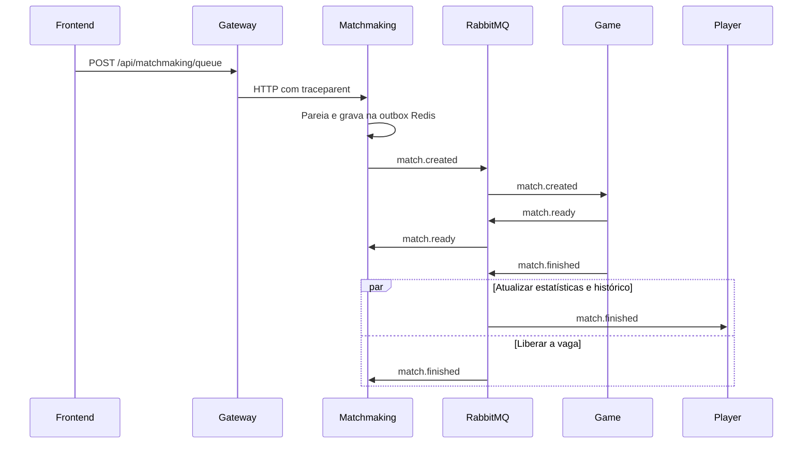

# Observabilidade do PongGame

O Compose executa OpenTelemetry Collector, Tempo para traces, Prometheus para métricas, Loki para logs e Grafana para consulta. Os dados ficam no volume `observability_data`. Grafana (3000) e OTLP/HTTP (4318) são publicados apenas no computador local.

## Ver uma partida no Grafana

1. Inicie o ambiente com `docker compose up --build -d --wait`.
2. Abra o [PongGame](http://localhost:8080) em duas abas e entre com uma conta diferente em cada uma.
3. Entre na fila nas duas abas. Quando a arena abrir, jogue até o fim ou clique em **Forfeit** para encerrar a partida.
4. Abra o [dashboard PongGame](http://127.0.0.1:3000/d/ponggame). Em **Traces de partidas**, clique no Trace ID mais recente e escolha **Abrir trace da partida**. Aguarde alguns segundos pela exportação. Se a tabela estiver vazia, confira o intervalo de tempo e atualize.
5. Na visualização **Trace da partida**, expanda os spans abaixo. Use `pong.match.id` para identificar a partida e `service.instance.id` para identificar a réplica do Game. Um `player.match.record` com `pong.match.recorded=true` indica que o resultado foi gravado.

## Spans por serviço e função

| Serviço | Função na partida | Spans e eventos |
| --- | --- | --- |
| Frontend (`ponggame-frontend`) | Envia a requisição para entrar na fila com o cabeçalho W3C `traceparent` | `POST /api/matchmaking/queue` |
| Gateway (`ponggame-gateway`) | Recebe a chamada HTTP e encaminha o contexto ao serviço | `POST /api/matchmaking` |
| Matchmaking (`ponggame-matchmaking`) | Pareia os jogadores e publica a solicitação pela outbox Redis | `matchmaking.pair` e `outbox.publish match.created` |
| Game (`ponggame-game`) | Consome `match.created`, provisiona a arena e publica `match.ready` | `game.match.created process`, `arena.provision` e `match.ready publish` |
| Matchmaking (`ponggame-matchmaking`) | Consome `match.ready` e disponibiliza os tickets para a arena | `matchmaking.match.ready process` |
| Game (`ponggame-game`) | Encerra a partida e publica o resultado | `game.match.finish` e `match.finished publish` |
| Player (`ponggame-player`) | Consome `match.finished`, atualiza ELO e grava o histórico em PostgreSQL | `player.match.finished process` e `player.match.record` |
| Matchmaking (`ponggame-matchmaking`) | Consome o mesmo `match.finished` e libera a vaga da arena | `matchmaking.match.finished process` |



O contexto W3C é salvo nos tickets junto com a entrada na fila. O pareamento usa o contexto do segundo ticket e vincula o primeiro quando ele pertence a outro trace. Isso mantém a ligação com o navegador também quando o agendador forma a partida após uma vaga ser liberada. As publicações recuperam o contexto das outboxes e o Game recupera o do estado da partida para o encerramento. Cada login no Auth é uma operação HTTP com trace próprio.

## Consultar o Tempo e o Loki

Para fazer buscas manuais, entre no Grafana e abra **Explore → Tempo**. Use esta consulta TraceQL para localizar a operação.

```traceql
{ resource.service.name = "ponggame-matchmaking" && span:name = "matchmaking.pair" }
```

Para buscar spans associados a uma partida específica, substitua `MATCH_ID` pelo identificador da partida:

```traceql
{ span.pong.match.id = "MATCH_ID" }
```

Em **Explore → Loki**, procure um Trace ID com `{service_name=~"ponggame-.+"} | trace_id="TRACE_ID"`. A leitura do Grafana é anônima. Para administrar os alertas, use `admin` e a senha `GRAFANA_ADMIN_PASSWORD` do `.env` (padrão local `pong_observability`).

## Configuração por função

| Função | Arquivo |
| --- | --- |
| Exportação de traces, métricas e logs da aplicação | [compose.yaml](../compose.yaml) |
| Tracing HTTP e encaminhamento de OTLP do navegador | [gateway/nginx.conf](../gateway/nginx.conf), [gateway/default.conf](../gateway/default.conf) |
| Recepção, filtragem e encaminhamento de telemetria | [collector.yaml](../infra/observability/collector.yaml) |
| Painéis por serviço, métricas e regras de alerta | [build_dashboards.py](../infra/observability/build_dashboards.py), [ponggame.json](../infra/observability/dashboards/ponggame.json), [alerts.yaml](../infra/observability/alerts.yaml) |

O Collector remove URLs completas, query strings e texto SQL dos spans. Os frames do jogo usam métricas agregadas. A amostragem local registra novas requisições de API e respeita a decisão de amostragem do contexto recebido. Para diagnosticar falhas de provisionamento, reentrega e compensação, consulte o [guia F1–F8](DEMO_FALHAS.md).
